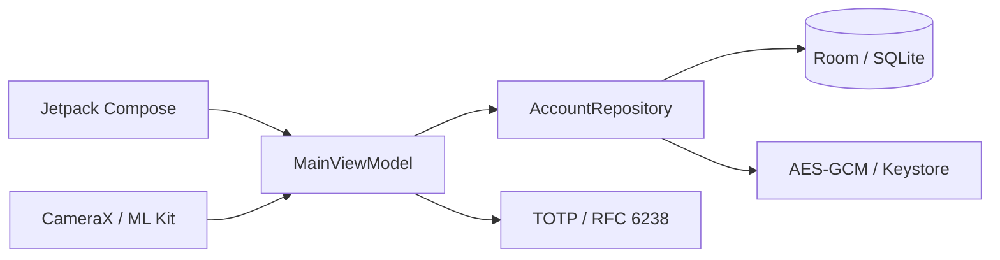

<p align="center">
  
</p>

<p align="center">
  
  
  
  
  
</p>

# 2FA Authenticator

Приложение для Android, которое хранит 2FA-аккаунты на телефоне и вычисляет одноразовые коды TOTP. Написано на **Kotlin и Jetpack Compose**. Отдельный сервер не требуется; QR-модель включена в APK, разрешение `INTERNET` отсутствует.

Учебный проект Занина Александра, группа **Пдоп-33**. Колледж экономики и информатики им. А. Н. Афанасьева УлГТУ, 2026 год.

## Для преподавателя

| Материал | Ссылка |
| --- | --- |
| Готовое приложение для телефона | [Скачать APK версии 1.0](downloads/Authenticator-1.0-debug.apk?raw=true) |
| Подробный отчёт Word | [30 страниц — разработка, технологии и 16 фрагментов кода](docs/02_Отчёт_2FA_Authenticator.docx?raw=true) |
| Первоначальный план | [План выполнения проекта](docs/01_План_2FA_Authenticator.docx?raw=true) |
| Открытие в Android Studio и запуск | [Пошаговая инструкция на русском](ЗАПУСК_НА_ТЕЛЕФОНЕ.md) |
| Архитектура и защита данных | [Техническое описание](docs/ARCHITECTURE.md) |
| Результаты проверок | [Что проверено и что ещё проверить на устройстве](ПРОВЕРКА.md) |
| QR для демонстрации | [Открыть учебный QR-код](demo/demo-qr.png) |

## Возможности

- Карточки аккаунтов с текущим кодом и круглым таймером.
- Поиск по названию сервиса и имени аккаунта, копирование нажатием, удаление с подтверждением.
- Добавление камерой, вручную или через `otpauth://totp/…` с проверкой перед сохранением.
- SHA1, SHA256 и SHA512; коды из 6–8 цифр; период 1–300 секунд. Стандартный профиль — 6 цифр / SHA1 / 30 секунд.
- Светлая, тёмная и системная темы.
- Блокировка через BiometricPrompt и защита скриншотов/обзора приложений.
- Шифрование всех полей аккаунта AES-256-GCM; ключ шифрования хранится в Android Keystore.

## Технологии

| Задача | Технология |
| --- | --- |
| Интерфейс | Jetpack Compose, Material 3 |
| Архитектура | MVVM + Repository |
| Локальные данные | Room / SQLite, KSP |
| Одноразовые коды | TOTP по RFC 6238, HMAC |
| Камера и распознавание | CameraX + встроенная модель ML Kit |
| Безопасность | AES-GCM, Android Keystore, BiometricPrompt |
| Состояние и асинхронность | Coroutines, Flow, StateFlow |
| Настройки | DataStore Preferences |



## Быстрый запуск

1. Скачайте репозиторий через **Code → Download ZIP** либо клонируйте его:

   ```bash
   git clone https://github.com/hikafgsas/2faauth.git
   ```

2. В Android Studio выберите **Open** и откройте корень проекта с `settings.gradle.kts`.
3. Дождитесь Gradle Sync и установки недостающего SDK. Проект использует **SDK 37, Build-Tools 36.0.0 и JDK 25**.
4. Подключите телефон Android 8.0+ с включённой отладкой по USB, выберите устройство и нажмите **Run**.

Для проверки без сборки установите [готовый APK](downloads/Authenticator-1.0-debug.apk?raw=true). Это отладочная сборка, не публикация в Google Play.

`local.properties` с путём к SDK Android Studio создаёт для каждого компьютера отдельно. Исходники, Gradle Wrapper, версии библиотек, схема Room и настройки сборки входят в репозиторий. Кеши и временные результаты сборки пересоздаются автоматически.

## Демонстрация

Откройте [учебный QR-код](demo/demo-qr.png) на компьютере. На телефоне нажмите **Добавить → Сканировать QR-код**, проверьте форму и сохраните аккаунт. Затем покажите таймер, копирование, поиск, смену темы и блокировку. Для проверки автономности включите авиарежим.

QR содержит **публичный тестовый секрет из RFC** и не подключает настоящий сервис. Для реального аккаунта нужен QR-код из его настроек безопасности и подтверждение кода на сайте сервиса.

## Исходный код

```text
app/src/main/java/com/example/authenticator/
├── MainActivity.kt               # системные функции Android
├── AuthenticatorApplication.kt   # зависимости приложения
├── SensitiveClipboard.kt        # копирование кода
├── core/                        # Base32, TOTP, otpauth, модель
├── data/                        # Room, Repository, AES-GCM, DataStore
└── ui/                          # ViewModel, экраны и темы Compose

app/src/test/                    # JVM-тесты алгоритма и парсера
app/src/androidTest/             # тесты Android Keystore и Room
app/schemas/                     # схема базы данных
demo/                            # демонстрационный QR и ссылка
docs/                            # план, отчёт Word, архитектура
downloads/                       # готовый проверенный APK
```

## Сборка и проверки

Windows PowerShell:

```powershell
.\gradlew.bat :app:assembleDebug :app:testDebugUnitTest :app:lintDebug
```

Linux / macOS:

```bash
./gradlew :app:assembleDebug :app:testDebugUnitTest :app:lintDebug
```

Локально прошли **7 JVM-тестов**, включая все **18 контрольных значений RFC 6238**. APK собран и подпись проверена. Android Lint завершился без ошибок, с 17 предупреждениями; подробности и ограничение одного библиотечного lint-check приведены в [отчёте проверки](ПРОВЕРКА.md).

Четыре инструментальных теста Keystore/Room скомпилированы, но на Android ещё не выполнялись. Камера, биометрия и интерфейс на конкретном телефоне требуют ручной проверки. Workflow в `.github/workflows/android.yml` предназначен для повторной сборки и JVM-проверок на GitHub Actions; его удалённый запуск проверяется отдельно от локальной сборки.

## Границы версии

Экспорт, синхронизация, HOTP и пакетный импорт Google Authenticator не реализованы. При удалении приложения секреты теряются — храните резервные коды сервисов отдельно. Блокировка изначально выключена и включается в настройках; защита экрана изначально включена.

Биометрия закрывает вход в интерфейс; AES-ключ этой версии не привязан к `CryptoObject`. Попытка очистки собственной копии в буфере через 30 секунд зависит от ограничений ОС. Полная модель защиты описана в [техническом документе](docs/ARCHITECTURE.md).
